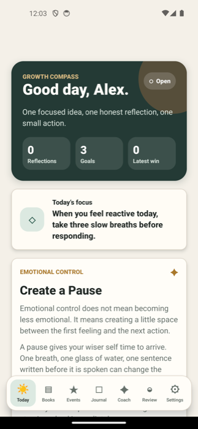
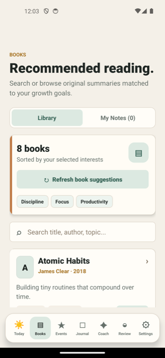
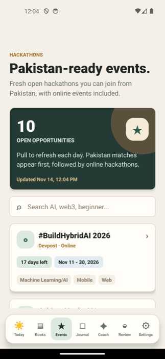
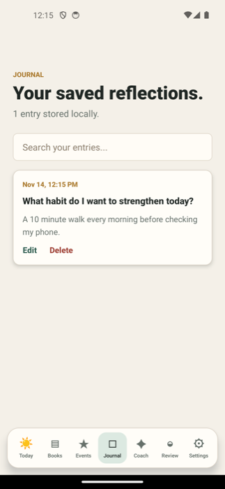

# Growth Compass

A local-first mobile app for self-growth: a daily lesson, a journal, book summaries, a weekly review, and an optional AI coach. Built with React Native (CLI, not Expo) and TypeScript.

Everything is stored on your device. There is no account and no backend. The AI features are optional and use your own OpenAI API key.

## Screenshots

<p>
  
  
  
  
</p>

## Features

- **Today**: a daily lesson and a journaling prompt matched to the goals you pick during onboarding.
- **Journal**: write entries, browse past ones, export your data.
- **Books**: original summaries of popular self-growth books with key ideas, action steps and reflection prompts. You can also search Open Library and save your own notes and answers per book.
- **Events**: a list of open online hackathons, with Pakistan-based ones first, from Devpost.
- **Coach** (optional): ask questions and get answers that take your recent journal entries into account.
- **Weekly review** (optional): an AI-written summary of your last seven days of journaling.
- **Spending cap**: AI calls are blocked once your estimated monthly spend reaches the budget you set in Settings.

## Requirements

- Node 20 or newer
- The React Native [environment setup](https://reactnative.dev/docs/set-up-your-environment) for Android (Android Studio, JDK 17) and/or iOS (Xcode, CocoaPods, Ruby)

## Run it

```bash
npm install
npm start            # Metro bundler

# in another terminal
npm run android
# or, on a Mac
cd ios && bundle install && bundle exec pod install && cd ..
npm run ios
```

## Scripts

| Command | What it does |
|---|---|
| `npm start` | Start the Metro bundler |
| `npm run android` / `npm run ios` | Build and run on a device or emulator |
| `npm run typecheck` | Type-check with TypeScript |
| `npm run lint` | Lint with ESLint |
| `npm test` | Run the Jest tests |
| `npm run apk` | Build a release APK at `android/app/build/outputs/apk/release/` |

The release build is signed with the debug keystore so it installs for personal use. To publish to an app store, create your own keystore and update `signingConfigs` in `android/app/build.gradle`.

## AI features and privacy

- Open **Settings** and paste an OpenAI API key to turn on the Coach and the weekly review. Without a key the rest of the app works as normal.
- Prompts are sent to `api.openai.com` only when you ask the coach a question or request a weekly review. They include your name, goals and recent journal entries.
- The key is stored in the app's local storage (AsyncStorage) on your device, which is **not encrypted**. Use a key with a hard spending limit set in your OpenAI dashboard, and do not use a key you rely on elsewhere.
- The in-app budget is an estimate based on token counts and list prices. It is not a billing guarantee.
- The default model is `gpt-5-nano`. You can change it in Settings.

## Network requests

| Service | Used for | When |
|---|---|---|
| OpenAI Responses API | Coach and weekly review | Only when you use those features |
| Open Library | Book search | When you search for books |
| Devpost (public hackathons endpoint) | Events tab | When you open the Events tab |

The Devpost endpoint is not an official, documented API and may change or stop working.

## Project layout

```
App.tsx                 Tab navigation and app state
src/screens/            One file per tab
src/components/         Shared UI pieces
src/services/           OpenAI, Open Library and Devpost clients
src/data/               Lessons, prompts, book summaries, default state
src/storage.ts          AsyncStorage persistence
__tests__/              Jest tests
```

## About the book summaries

The summaries in `src/data/books.ts` are written in original words and cite the source book. They are not excerpts. Please keep contributions to the same standard: no copied passages.

## Contributing

Issues and pull requests are welcome. Before opening a pull request, run:

```bash
npm run typecheck && npm run lint && npm test
```

## License

[MIT](LICENSE)
